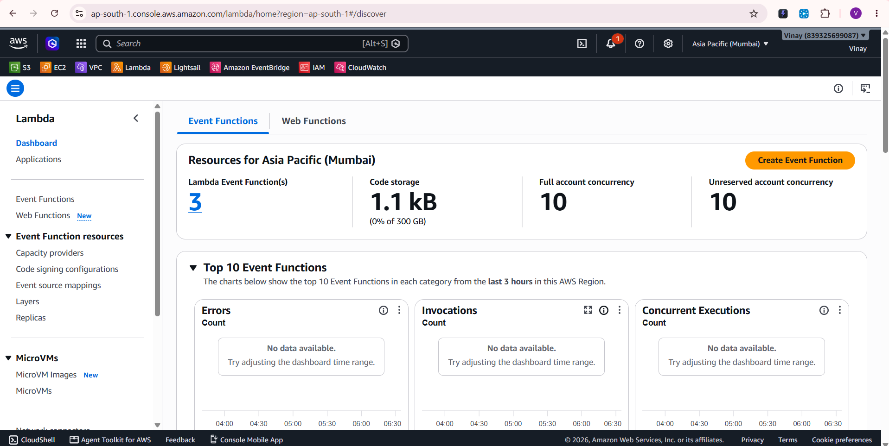
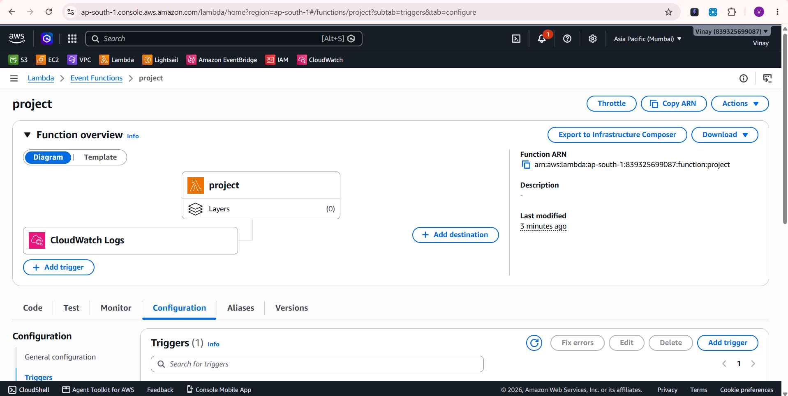
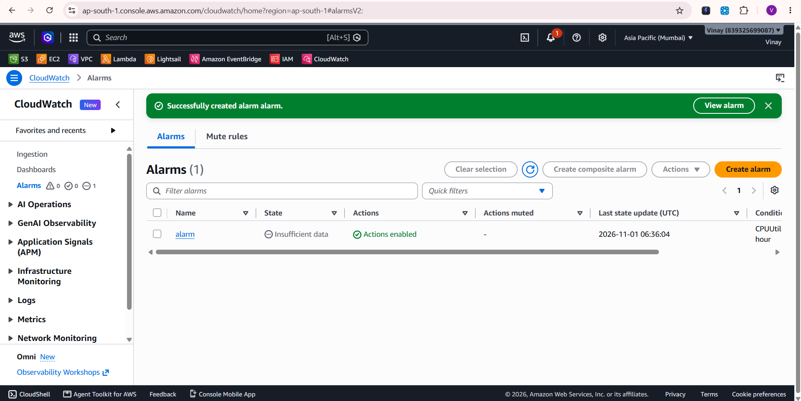
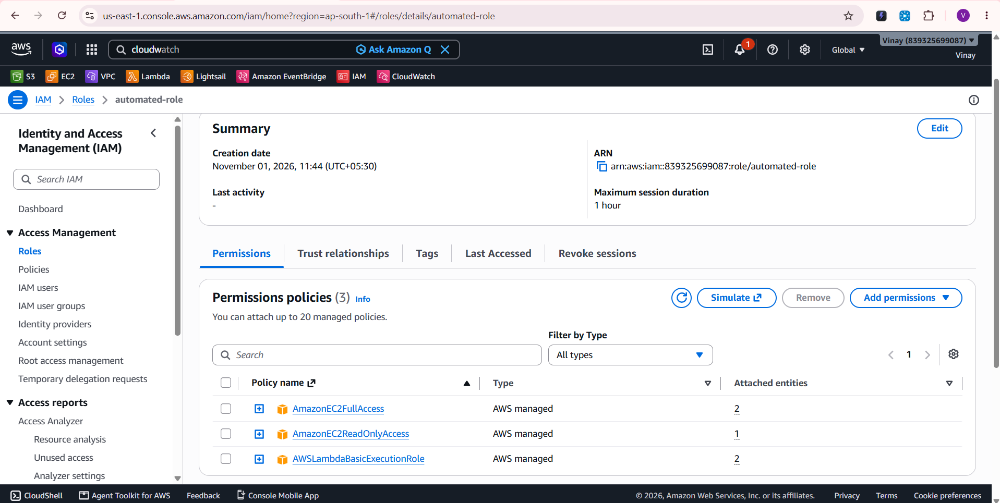
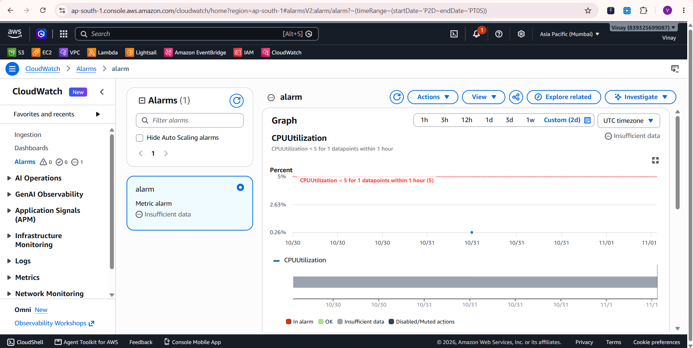

# Automated Cost Optimization: Stop Unused EC2 Instances with AWS Lambda

Automatically detect idle EC2 instances (low CPU utilization) and stop them using **Amazon CloudWatch**, **Amazon SNS**, **AWS Lambda** and **Boto3**, reducing unnecessary cloud spend.

**Region:** Asia Pacific (Mumbai) `ap-south-1`

---

## Architecture

```
EC2 Instance
     │  (CPUUtilization metric)
     ▼
CloudWatch Alarm  ── CPU < 5% for 1 hour ──►  SNS Topic  ──►  Lambda Function
                                                                    │
                                                                    ▼
                                                      Checks CPU, stops idle EC2
```

## Services Used

| Service | Purpose |
|---|---|
| Amazon EC2 | Instances being monitored |
| Amazon CloudWatch | Collects `CPUUtilization` and raises the alarm |
| Amazon SNS | Delivers the alarm notification to Lambda |
| AWS Lambda | Checks CPU usage and stops idle instances |
| AWS IAM | Execution role for the Lambda function |
| Boto3 (Python) | AWS SDK used inside Lambda |

## Resources Created

| Resource | Name |
|---|---|
| Lambda function | `project` |
| IAM role | `automated-role` |
| CloudWatch alarm | `alarm` |
| Alarm condition | `CPUUtilization < 5` for 1 datapoint within 1 hour |

---

## Prerequisites

- An AWS account with permission to use IAM, Lambda, CloudWatch, SNS and EC2
- At least one running EC2 instance
- CloudWatch metrics available for the instance (basic monitoring gives 5-minute datapoints)

---

## Implementation Steps

### 1. Create the IAM role
1. Open **IAM → Roles → Create role**
2. Trusted entity: **AWS service → Lambda**
3. Attach these policies:
   - `AmazonEC2ReadOnlyAccess` – read EC2 details
   - `AWSLambdaBasicExecutionRole` – write logs to CloudWatch Logs
   - `AmazonEC2FullAccess` – stop EC2 instances
4. Name the role `automated-role` and create it

> **Security note:** `AmazonEC2FullAccess` is used for simplicity. For production, replace the managed policies with a least-privilege custom policy allowing only `ec2:DescribeInstances`, `ec2:StopInstances` and `cloudwatch:GetMetricStatistics`.

### 2. Create the Lambda function
1. Open **Lambda → Create function → Author from scratch**
2. Function name: `project`
3. Runtime: **Python 3.x**
4. Execution role: **Use an existing role → `automated-role`**
5. Paste the code from [`lambda_function.py`](lambda_function.py) and click **Deploy**
6. Go to **Configuration → General configuration → Edit** and set **Timeout to 1 min** (the default 3 seconds is too short)

### 3. Create the CloudWatch alarm
1. Open **CloudWatch → Alarms → Create alarm**
2. Select metric **EC2 → Per-Instance Metrics → CPUUtilization** for your instance
3. Condition: **Lower than 5**, evaluated over a period of **1 hour**
4. Notification: create or select an **SNS topic**
5. Name the alarm `alarm` and create it

### 4. Connect SNS to Lambda
1. Open the Lambda function `project` → **Add trigger**
2. Select **SNS**
3. Choose the SNS topic used by the alarm
4. Click **Add**

---

## Lambda Logic

See [`lambda_function.py`](lambda_function.py).

1. Lists all **running** EC2 instances
2. Skips instances tagged `AutoStop = false`
3. Reads the last hour of `CPUUtilization` datapoints from CloudWatch
4. Skips instances with fewer than 6 datapoints (e.g., recently launched)
5. Stops the instance if average CPU is **below 5%**

---

## Testing

1. Use a **non-critical test instance** that has been running for at least 30 to 60 minutes with low CPU. Tag any instance you want protected with `AutoStop = false`.
2. **Direct test:** in Lambda open the **Test** tab, create a test event with `{}` and click **Test**.
3. **End-to-end test:** wait for the CloudWatch alarm to enter **In alarm**, which publishes to SNS and triggers Lambda.
4. Verify in **CloudWatch Logs** (`/aws/lambda/project`) that the function logged `Stopped instance: <id>`, and in **EC2** that the instance state is **Stopped**.

---

## Screenshots

### Lambda Dashboard


### Lambda Function Overview (`project`)


### CloudWatch Alarm Created


### IAM Role (`automated-role`)


### CPU Utilization Alarm Graph


---

## Monitoring and Troubleshooting

- Check **CloudWatch Logs** for Lambda errors
- Alarm state `Insufficient data` means CloudWatch is not receiving CPU metrics (for example, the monitored instance is stopped)
- If the function times out, increase the Lambda timeout
- Adjust the CPU threshold and lookback window as needed

## Limitations

- Stopping an instance stops compute charges, but **EBS volumes and Elastic IPs still incur cost**
- CPU alone is an imperfect idle indicator (network and disk activity are ignored)
- The function evaluates all running instances in the region, not only the one that triggered the alarm. Use the `AutoStop=false` tag to protect important instances

## Future Improvements

- Send an email notification via SNS when an instance is stopped
- Parse the alarm event to act only on the triggering instance
- Include network and disk metrics in the idle check
- Replace managed policies with a least-privilege custom policy
- Deploy with Terraform or CloudFormation

## Conclusion

This project automates EC2 cost optimization by detecting and stopping idle instances, reducing unnecessary spend and improving resource management.

## Author

**Vinay** – [GitHub](https://github.com/Vinay-PR-Gowda)
